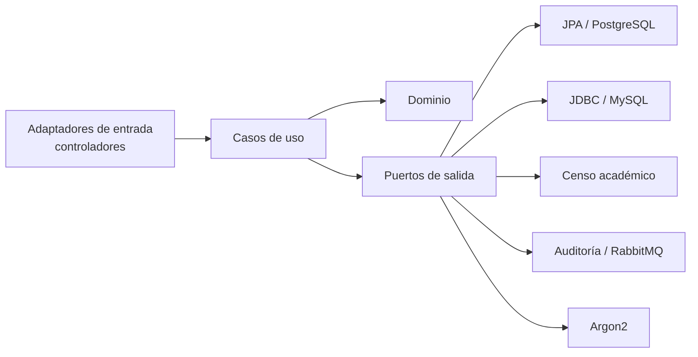

# Sistema de Votaciones Estudiantiles

Sistema de elecciones universitarias en **Java 21** y **Spring Boot 4**, organizado con **arquitectura hexagonal**.

El hexágono es el paquete `votacion`. Adentro viven el dominio, los casos de uso y los adaptadores. Afuera queda `academicmock`, que simula el censo de la universidad. La votación lo consulta a través del puerto `CensoAcademico`.

El perfil activo elige el adaptador de persistencia:

- `postgres` (predeterminado): JPA contra PostgreSQL.
- `mysql`: JDBC contra MySQL.

Cambiar de base de datos deja intactos el dominio y los casos de uso.

---

## Arquitectura hexagonal

Las dependencias apuntan hacia el centro. El dominio no importa Spring, JPA ni JDBC. Los servicios de aplicación dependen de puertos (interfaces). La infraestructura implementa esos puertos y es el único lugar donde aparecen el framework, las bases y RabbitMQ.



```
src/main/java/com/universidad/votaciones/
├── VotacionesApplication.java
├── academicmock/                              # Sistema externo simulado
└── votacion/
    ├── dominio/
    ├── aplicacion/
    │   ├── puertos/entrada/                   # Casos de uso
    │   ├── puertos/salida/                    # Lo que la aplicación necesita del mundo
    │   └── servicios/                         # Implementan los casos de uso
    └── infraestructura/
        ├── entrada/                           # HTTP
        ├── config/                            # VotacionConfig arma el hexágono
        └── salida/
            ├── jpa/                           # Perfil postgres
            ├── mysql/                         # Perfil mysql
            ├── censo/
            ├── auditoria/
            └── seguridad/
```

Los puertos son solo interfaces. `HechoElectoral`, `EstadoJornada` y `EstadoVotante` son enums del dominio.

### Dominio

Aquí están las reglas. `MesaDeVotacion` decide si un voto se acepta. `JornadaElectoral` decide si el día está abierto.

- La jornada dura un día, de 08:00 a 16:00 inclusive. `iniciar` y `cerrar` son operaciones distintas. Una jornada `CERRADA` no vuelve a abrirse. Iniciar fuera de ese horario se rechaza. Un voto exige jornada `ABIERTA`, el mismo día calendario y una hora dentro de la ventana.
- Cada estudiante vota una sola vez. Si llega la misma llave de idempotencia, `MesaDeVotacion` devuelve la participación ya registrada y no arma otra papeleta. Otra llave para el mismo estudiante lanza `VotanteYaVotoException`.
- El voto es anónimo. `IntencionDeVoto` todavía conoce al estudiante y al candidato. El único camino a la urna es `privatizar`, que produce una `Papeleta` con el candidato y un identificador aleatorio. La `Participacion` guarda al estudiante, la llave y el recibo, y no conoce al candidato.
- Sin el código del estudiante en el padrón cargado, el voto se rechaza.
- `Votante` y `Administrador` modelan a las personas. La contraseña en claro no forma parte de esos objetos: el hash lo produce el puerto `CodificadorDeClaves` y lo guarda el repositorio.

`ReglaDeNegocioVioladaException` cubre horario, padrón, candidato inexistente y jornada inválida.

### Puertos de entrada

Cada caso de uso es una interfaz en `aplicacion/puertos/entrada`. Los controladores dependen de estas interfaces.

| Puerto | Responsabilidad |
|---|---|
| `IniciarJornadaUseCase` | Abre la jornada del día |
| `CerrarJornadaUseCase` | Cierra la jornada abierta |
| `CargarPadronUseCase` | Copia al padrón los códigos habilitados del censo |
| `EmitirVotoUseCase` | Deposita un voto anónimo y devuelve el recibo |
| `RegistrarCandidatoUseCase` | Agrega un candidato al tarjetón |
| `ConsultarJornadaUseCase` | Describe el estado de la jornada |
| `ConsultarCandidatosUseCase` | Lista el tarjetón |
| `ConsultarParticipacionUseCase` | Indica si un estudiante ya votó |
| `ConsultarResultadosUseCase` | Cuenta las papeletas de la urna |
| `RegistrarVotanteUseCase` | Registra un votante, con o sin verificación contra el censo |
| `ConsultarVotanteUseCase` | Consulta votantes |
| `CambiarEstadoVotanteUseCase` | Cambia el estado del votante |
| `RegistrarAdministradorUseCase` | Registra un administrador |
| `ConsultarAdministradorUseCase` | Consulta administradores y los activa o desactiva |

`ConsultarVotacionService` implementa las cuatro consultas de la elección. `ConsultarVotanteService` implementa la consulta y el cambio de estado. `RegistrarAdministradorService` implementa el alta y la consulta de administradores. Son un solo objeto por grupo: cada método conserva su nombre propio.

### Puertos de salida

Los servicios piden al exterior solo lo que declaran estas interfaces:

| Puerto | Qué pide la aplicación |
|---|---|
| `JornadaRepository` | Leer y guardar la jornada |
| `PadronRepository` | Reemplazar el padrón y saber si un código está cargado |
| `ParticipacionRepository` | Buscar por llave, saber si ya votó y guardar la participación |
| `UrnaRepository` | Depositar la papeleta y escrutar |
| `CandidatoRepository` | Saber si el candidato existe y listar el tarjetón |
| `VotanteRepositorio` | Alta, consulta y estado del votante |
| `AdministradorRepositorio` | Alta, consulta y activación del administrador |
| `CensoAcademico` | Códigos habilitados y verificación de un código |
| `Reloj` | La hora con la que se evalúa la jornada |
| `RegistroDeAuditoria` | `exito` o `fallo` de un `HechoElectoral` |
| `CodificadorDeClaves` | Hash de la contraseña |

### Servicios de aplicación

Viven en `aplicacion/servicios` y son clases normales, construidas a mano. Orquestan puertos y delegan la regla en el dominio.

`EmitirVotoService` consulta la llave, el padrón, el voto previo y el tarjetón, y llama a `MesaDeVotacion.emitir`. Si la emisión es nueva, guarda la participación y deposita la papeleta. El reintento idempotente se resuelve antes de exigir la jornada, así que la misma llave sigue devolviendo el recibo original después del cierre. Cada resultado se audita: `VOTO_REGISTRADO`, `VOTO_REINTENTO`, `VOTO_DUPLICADO` o `VOTO_RECHAZADO`.

`CargarPadronService` pide al censo la lista de habilitados y la deja en `PadronRepository`. El voto posterior mira ese padrón, no vuelve a llamar al censo.

`RegistrarVotanteService.registrar` deja al votante en `PENDIENTE_VERIFICACION`. `registrarVerificadoEnCenso` lo pasa a `HABILITADO` cuando el censo lo reconoce. El alta HTTP usa el primer método.

### Adaptadores de entrada

Son los controladores de `infraestructura/entrada`. Cada uno traduce HTTP a un caso de uso.

- `VotacionController` (`/api/v1/votaciones`): jornada, padrón, tarjetón, voto, participación y escrutinio. El header `Idempotency-Key` reemplaza la llave del cuerpo. `VotanteYaVotoException` responde 409. `ReglaDeNegocioVioladaException` responde 422.
- `VotanteController` (`/api/auth/votantes`): alta, consulta y cambio de estado.
- `AdministradorController` (`/api/auth/administradores`): alta, listado, activación y desactivación.
- `ManejadorDeErroresHttp` convierte el resto de excepciones de dominio, como el correo duplicado, en 400.

`RegistroAcademicoController` (`/api/academic`) pertenece a `academicmock`. Expone el censo simulado y no es un adaptador del hexágono de votación.

### Adaptadores de salida

Dos juegos implementan los mismos puertos de persistencia. Spring crea uno u otro según el perfil.

**PostgreSQL (`@Profile("postgres")`).** El paquete `salida/jpa` tiene un archivo por concepto. Ahí conviven la entidad, el repositorio de Spring Data y el adaptador que implementa el puerto. `PostgresJpaConfig` limita el escaneo JPA y Spring Data a ese paquete. Los usuarios usan herencia `JOINED`: `usuarios`, `votantes_estudiantes` y `usuarios_administradores`.

**MySQL (`@Profile("mysql")`).** El paquete `salida/mysql` habla por JDBC. `EsquemaMysql` crea las tablas al arrancar. Los `INSERT` usan la forma de MySQL 8 con alias y `ON DUPLICATE KEY UPDATE`.

En ambos perfiles la urna y la participación quedan separadas:

| Dato | Participación (`transacciones_voto_idempotente`) | Papeleta (`papeletas_voto`) |
|---|---|---|
| Estudiante | sí | no |
| Llave de idempotencia | sí | no |
| Candidato | no | sí |
| Columna `token_anonimo` | el recibo que se devuelve al votante | un UUID nuevo, distinto del recibo |

La papeleta guarda ese sello para que las dos tablas no se puedan unir por el recibo.

Los demás adaptadores están siempre activos:

- `CensoAcademicoAdaptador` implementa `CensoAcademico` llamando a `AcademicApi`.
- `CodificadorArgon2` implementa `CodificadorDeClaves`.
- `RegistroDeAuditoriaAdaptador` traduce el `HechoElectoral` y lo publica en RabbitMQ. Un worker persiste el evento en `auditoria_eventos` con JPA. `AuditoriaJpaConfig` registra solo esa entidad, en los dos perfiles. Si RabbitMQ no responde, el adaptador registra el aviso y la operación de negocio sigue.

Al arrancar, si el tarjetón está vacío, `VotacionConfig` siembra a Carlos Mendoza, Laura Restrepo y el voto en blanco.

### Composición

`VotacionConfig` es la raíz de composición. Crea los servicios, les pasa los puertos y publica los casos de uso como beans. Las escrituras de jornada, padrón, voto, candidato y votante quedan envueltas en `TransactionTemplate` cuando hay un `PlatformTransactionManager`.

El reloj sale de `votacion.reloj`. Sin la propiedad, o con el valor `sistema`, usa la hora real. Un ISO-8601 fijo deja la hora quieta, que es lo que hacen las pruebas.

### Censo académico

`academicmock` simula el sistema externo. Genera un censo de estudiantes habilitados y lo expone por `AcademicApi` y por `/api/academic`. El hexágono no entra a sus servicios internos: solo usa el puerto `CensoAcademico`. Cargar el padrón es un comando explícito. La aplicación no abre la jornada ni copia el censo al iniciar.

### Pruebas de la arquitectura

`ReglasDeVotacionTest` ejercita el dominio sin Spring. `EmitirVotoServiceTest` usa dobles en memoria de los puertos de salida, que viven solo en `src/test` y no son un perfil de producción. `VotacionesEndToEndTest` levanta el adaptador JPA del perfil `postgres` sobre H2, con el reloj fijado a las 10:00 para que la ventana 08:00–16:00 no dependa de la hora en que se corre la prueba.

---

## Requisitos

- Docker Desktop con Compose v2
- Java JDK 21, si se ejecuta fuera del contenedor de la aplicación
- Postman, para la colección incluida

---

## Cómo ejecutar

### Entorno

Compose solo levanta PostgreSQL, MySQL y RabbitMQ. La aplicación se ejecuta aparte, con Gradle.

Desde la carpeta `votaciones`:

```bash
docker compose up -d
```

PostgreSQL queda en `localhost:5432` (`postgres` / `postgres`, base `votaciones_db`).
MySQL queda en `localhost:3307` (`votaciones` / `votaciones`, base `votaciones_db`). El contenedor escucha el 3306 por dentro; en el host se publica el 3307 porque el 3306 ya lo usa el MySQL instalado en Windows.
RabbitMQ queda en `localhost:5672`. El panel está en `http://localhost:15672` (`guest` / `guest`).

### Aplicación con Gradle

Perfil PostgreSQL, que es el predeterminado:

```bash
# Linux / macOS
./gradlew bootRun

# Windows
.\gradlew.bat bootRun
```

Perfil MySQL:

```bash
# Linux / macOS
./gradlew bootRun --args="--spring.profiles.active=mysql"

# Windows
.\gradlew.bat bootRun --args="--spring.profiles.active=mysql"
```

La aplicación queda en `http://localhost:8080`.

Para detener el entorno:

```bash
docker compose down
```

`docker compose down -v` borra también los volúmenes de las bases.

---

## Pruebas

Las pruebas de dominio y de aplicación no levantan PostgreSQL ni MySQL. La prueba de extremo a extremo usa el adaptador JPA sobre H2.

Todas las pruebas:

```bash
# Linux / macOS
./gradlew test

# Windows
.\gradlew.bat test
```

Solo las unitarias (dominio y caso de uso de emitir voto):

```bash
# Linux / macOS
./gradlew test --tests "com.universidad.votaciones.votacion.*"

# Windows
.\gradlew.bat test --tests "com.universidad.votaciones.votacion.*"
```

Una clase concreta, el equivalente a `mvn test -Dtest=NombreDeLaClase`:

```bash
# Linux / macOS
./gradlew test --tests com.universidad.votaciones.votacion.dominio.ReglasDeVotacionTest
./gradlew test --tests com.universidad.votaciones.votacion.aplicacion.EmitirVotoServiceTest
./gradlew test --tests com.universidad.votaciones.e2e.VotacionesEndToEndTest

# Windows
.\gradlew.bat test --tests com.universidad.votaciones.votacion.dominio.ReglasDeVotacionTest
.\gradlew.bat test --tests com.universidad.votaciones.votacion.aplicacion.EmitirVotoServiceTest
.\gradlew.bat test --tests com.universidad.votaciones.e2e.VotacionesEndToEndTest
```

---

## Postman

1. Importe `votaciones_postman_collection.json` y `votaciones_postman_environment.json`.
2. Active el entorno **Votaciones Estudiantiles - Local**.
3. Ejecute la colección **Sistema de Votaciones Estudiantiles**.

La jornada solo puede iniciar entre las 08:00 y las 16:00.

---

## Endpoints

| Método | Ruta | Descripción |
|---|---|---|
| `GET` | `/actuator/health` | Salud de la aplicación |
| `GET` | `/api/academic/estudiantes/{codigo}/validar` | Valida el estudiante en el censo |
| `GET` | `/api/academic/estudiantes/{codigo}` | Ficha del estudiante |
| `GET` | `/api/academic/estudiantes/cantidad` | Total del censo |
| `POST` | `/api/auth/administradores` | Registra un administrador |
| `GET` | `/api/auth/administradores` | Lista administradores |
| `GET` | `/api/auth/administradores/activos` | Lista administradores activos |
| `POST` | `/api/auth/votantes` | Registra un votante |
| `GET` | `/api/auth/votantes/codigo/{codigo}` | Consulta un votante por código |
| `PATCH` | `/api/auth/votantes/{id}/estado?estado=HABILITADO` | Cambia el estado del votante |
| `GET` | `/api/auth/votantes/habilitado/{codigo}` | Indica si el votante está habilitado |
| `POST` | `/api/v1/votaciones/padron/cargar` | Carga el padrón desde el censo |
| `POST` | `/api/v1/votaciones/jornada/iniciar` | Abre la jornada |
| `POST` | `/api/v1/votaciones/jornada/cerrar` | Cierra la jornada |
| `GET` | `/api/v1/votaciones/jornada` | Consulta la jornada |
| `GET` | `/api/v1/votaciones/candidatos` | Lista el tarjetón |
| `POST` | `/api/v1/votaciones/votar` | Emite un voto. Acepta el header `Idempotency-Key` |
| `GET` | `/api/v1/votaciones/estudiante/{id}/ha-votado` | Indica si el estudiante ya votó |
| `GET` | `/api/v1/votaciones/resultados` | Escrutinio de la urna |
